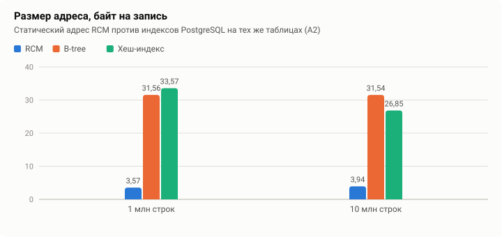
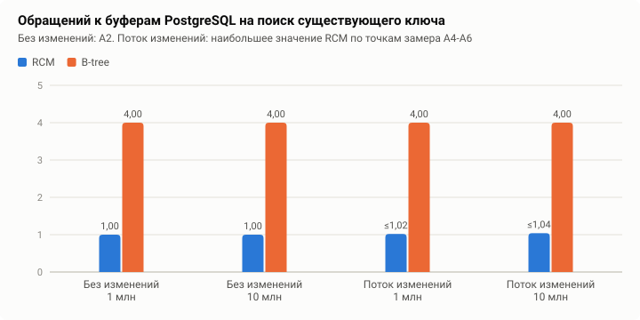
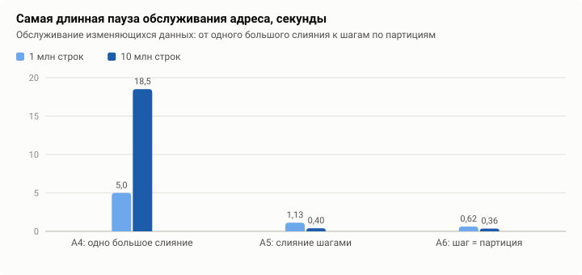
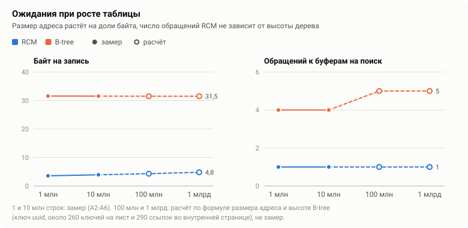

# RCM Path: вычисляемая адресация записей в PostgreSQL

RCM Address Engine вычисляет номер страницы кучи PostgreSQL, на которой лежит запись, по её ключу. Адрес состоит из
каскада минимальной совершенной хеш-функции, 8-битного отпечатка и номера страницы и занимает 3,6-3,9 байта на запись
против 31,5 байта у B-tree. При поиске читается одна страница таблицы (узел плана Tid Range Scan), после чего
проверяется ключ.

Движок работает рядом с PostgreSQL как модуль на Python и подключается к серверу через стандартное клиентское
соединение (sidecar). Изменения сервера не требуются.

Свойства адресации исследованы в экспериментах A2-A7 на таблицах из 1 и 10 млн строк, на неизменных данных и под
потоком вставок, обновлений и удалений. Для эксперимента A8 подготовлены протокол, код и самопроверка.

Автор: Abu ([@tymakbayev](https://github.com/tymakbayev)).

## Ключевые результаты

- Адрес в 8-9 раз компактнее B-tree: 3,57 / 3,94 байта на запись против 31,56 / 31,54 на 1 и 10 млн строк.
- Поиск существующего ключа обращается к одной странице таблицы против четырёх у B-tree; при росте таблицы с 1 до
  10 млн строк число обращений не меняется.
- Под потоком из 500 000 вставок, обновлений и удалений адрес сохраняет 1,00-1,04 обращения на поиск.
- 99,5% отсутствующих ключей отсеиваются без обращения к таблице.
- Ни одного неверного ответа во всех предусмотренных проверках правильности.
- Самая длинная пауза обслуживания адреса на 10 млн строк сокращена с 18,5 до 0,36 с.

<picture>
  <source media="(prefers-color-scheme: dark)" srcset="docs/img/size-dark.svg">
  
</picture>

<picture>
  <source media="(prefers-color-scheme: dark)" srcset="docs/img/buffers-dark.svg">
  
</picture>

<picture>
  <source media="(prefers-color-scheme: dark)" srcset="docs/img/pauses-dark.svg">
  
</picture>

| Показатель | RCM | B-tree |
|---|---|---|
| Байт на запись, 1 / 10 млн строк | 3,57 / 3,94 | 31,56 / 31,54 |
| Обращений к буферам PostgreSQL на поиск существующего ключа | 1 | 4 |
| То же под потоком изменений, 1 и 10 млн строк | 1,00-1,04 | 4,00-4,06 |
| Отсутствующие ключи, отсеянные без запроса к таблице | 99,5% | - |
| Неверных ответов в проверках правильности | 0 | 0 |
| Самая длинная пауза обслуживания адреса, 1 / 10 млн строк (A6) | 0,62 / 0,36 с | - |
| Задержка поиска в клиенте на Python, p50, 1 млн строк | 177 мкс | 101 мкс |

Учитываются обращения к буферам PostgreSQL; чтение адресного файла в них не входит. Задержка измерена для клиента на
Python; нативная реализация поиска не измерялась. Условия измерений и все эксперименты:
[docs/results.md](docs/results.md).

## Ожидания при росте объёма

<picture>
  <source media="(prefers-color-scheme: dark)" srcset="docs/img/projection-dark.svg">
  
</picture>

Значения для 100 млн и 1 млрд строк получены расчётом, а не замером. Размер адреса растёт только за счёт номера
страницы, на один бит при каждом удвоении таблицы: около 4,3 байта на запись при 100 млн и 4,8 при 1 млрд строк. Это
около 0,43 и 4,8 ГБ против примерно 3,2 и 31,5 ГБ у B-tree, то есть адрес таблицы в миллиард строк помещается в
оперативную память обычного сервера. Высота B-tree при этом увеличивается, и поиск требует пяти обращений к буферам;
вычисляемый адрес по-прежнему обращается к одной странице. Проверка этих ожиданий на больших таблицах входит в
[открытые вопросы](#независимая-проверка). Методика расчёта: [docs/results.md](docs/results.md#ожидания-при-росте-объёма).

## Как появилась идея

RCM Path начинался как исследование компактной долговременной памяти голосового ассистента: запись хранится как
генератор, траектория и остаток (Reconstructive Compact Memory). В экспериментах по сжатию без потерь выяснилось,
что хранимый поисковый индекс снижает коэффициент сжатия с 11,5× до 3,5×. Отсюда возник вопрос: если содержимое
восстанавливается вычислением, нельзя ли так же вычислять местоположение записи по ключу, вместо того чтобы хранить
индекс? Ответом стал адресный движок, подключённый к PostgreSQL. Подробно: [docs/history.md](docs/history.md).

## Быстрый запуск

Требуются Python 3.10+ и PostgreSQL 17 или 18 с базой, в которой роль может создавать таблицы. Права суперпользователя
не нужны.

```sh
git clone https://github.com/tymakbayev/RCM_Path.git
cd RCM_Path
python -m venv .venv
. .venv/bin/activate                  # Windows: .venv\Scripts\activate
pip install -r requirements.txt
cd rcm_address_engine
export PGHOST=localhost PGPORT=5432 PGUSER=postgres PGPASSWORD=...   # Windows: set PGHOST=... и т. д.
python demo.py --rows 200000          # по умолчанию 1 млн строк, около 0,65 ГБ
```

Демо создаёт отдельную таблицу, строит по ней B-tree и адрес RCM, выполняет одни и те же поиски обоими способами и
сверяет каждый ответ с эталоном генератора. После завершения таблица и файлы удаляются. Результат на эталонном стенде
(PostgreSQL 18.7, роль без прав суперпользователя, [JSON](results/demo_reference_200k.json)):

| 200 000 строк, 20 000 поисков | RCM | B-tree |
|---|---|---|
| Байт на запись | 3,19 | 31,66 |
| Буферов на поиск: ключ есть / нет | 1,00 / 0,007 | 4,00 / 3,00 |
| Задержка p50 / p95, мкс (клиент на Python) | 144 / 185 | 111 / 134 |
| Неверных ответов | 0 | 0 |
| План запроса | Tid Range Scan | Index Scan |

База задаётся переменной `RCM_DB`, по умолчанию `a2`.

## Использование с собственной таблицей

```python
import psycopg
import rcm                                   # из папки rcm_address_engine

conn = psycopg.connect("host=localhost dbname=mydb user=me", autocommit=True)
rcm.build(conn, "public.items", "id", "items.adr")   # адрес по колонке-ключу uuid

with rcm.Address.open("items.adr") as addr:
    addr.check(conn)                         # таблица не переписана после сборки
    row = addr.get(conn, some_uuid)          # строка или None
```

Поддерживается обычная таблица с уникальным ключом `uuid`. Адрес соответствует снимку таблицы на момент сборки. Для
строк, вставленных или перемещённых позже, предусмотрен `get(..., fallback=True)`; при интенсивных изменениях адрес
пересобирается. Условия и проверка: [docs/integration.md](docs/integration.md).

## Устройство

```
ключ ──hash64──► h ──► каскад битовых карт (≈3 бита на ключ) ──► ячейка ──► отпечаток 8 бит | номер страницы
SELECT … WHERE ctid >= '(page,0)' AND ctid < '(page+1,0)' AND key = $1     одна страница таблицы, проверка ключа
```

Ключи и дерево поиска не хранятся; хранится вычисляемая функция «ключ → страница». Изменяющиеся данные (A4-A6)
обслуживаются уровнями адресов с пошаговым слиянием по хеш-партициям таблицы. Описание: [docs/design.md](docs/design.md).
Основой служит модель RCM Path «генератор + траектория + остаток»: [docs/theory](docs/theory/README.md).

## Ограничения

Адрес обслуживает точечный поиск по ключу. Диапазонные запросы и упорядоченный обход, например выборка по датам,
выполняются обычным индексом. Остальные свойства измерены на одном стенде на таблицах из 1 и 10 млн строк; их
проверка на другом оборудовании и больших объёмах описана ниже.

## Независимая проверка

Измерения выполнены на одной машине. Открытые вопросы:

1. Размер адреса, число обращений к буферам и задержка на другом оборудовании и других версиях PostgreSQL (демо).
2. Эксперимент A8 на 10 млн строк: причина двукратного замедления поиска в одиночной таблице при совместной работе
   трёх таблиц по 6,4 ГБ. Требуется не менее 24 ГБ свободного места.
3. A6 и A7 на 10 млн строк и больше: поведение цены обслуживания и самой длинной паузы с ростом таблицы.
4. Linux, NVMe, увеличенный `shared_buffers`.
5. Нативная реализация поиска (C, метод доступа индекса): задержка по сравнению с B-tree.

Порядок повторения экспериментов: [docs/reproduce.md](docs/reproduce.md). Результаты принимаются через issue по
шаблону «Результаты» с файлами из `results/`, описанием оборудования и настройками PostgreSQL.

## Структура репозитория

```
rcm_address_engine/     код: движок, API, демо, тесты, эксперименты A2-A8 (карта в README папки)
docs/
  results.md            результаты A2-A8, ожидания при росте объёма, условия измерений
  history.md            история идеи
  integration.md        использование с собственной таблицей
  design.md             устройство адреса и обслуживание изменений
  reproduce.md          повторение экспериментов
  experiments/          протоколы, приложения и отчёты A2-A8
  theory/               модель RCM Path
  method/               методика исследования
  img/                  графики и скрипт их построения
results/                эталонные результаты: JSON, логи, хеши протоколов и данных
```

## Методика и лицензия

Работа выполнена по методике автора: [docs/method](docs/method/README.md).

Лицензия [MIT](LICENSE). Цитирование: [CITATION.cff](CITATION.cff).
