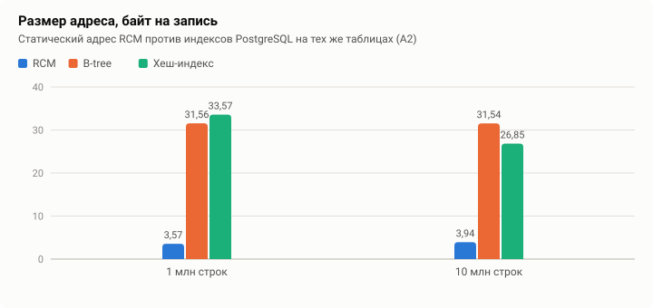
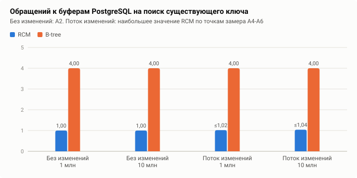
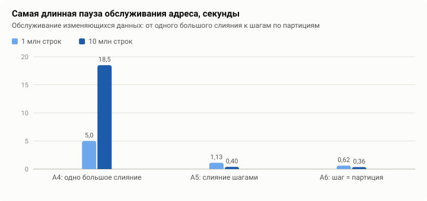
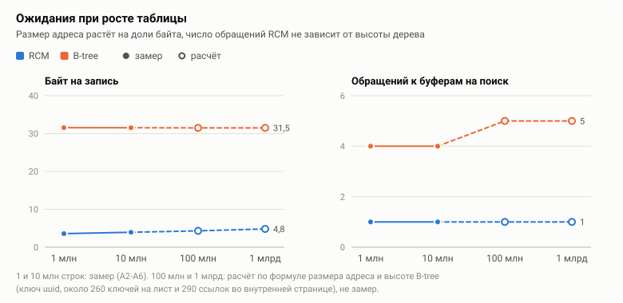

# Результаты экспериментов A2-A8

Эталонный стенд описан [ниже](#эталонный-стенд). PostgreSQL 18.7 с настройками по умолчанию (`shared_buffers`
128 МБ), тёплый кэш ОС. Числа являются замерами, если не помечены как вывод. Обозначения 1M и 10M соответствуют 1 и
10 млн строк. Сырые данные лежат в [`results/`](../results/README.md), отчёты с полными таблицами в
[`experiments/`](experiments/).

## Сводная таблица

| Показатель | Результат | Источник |
|---|---|---|
| Размер статического адреса, байт на строку, 1M / 10M | 3,57 / 3,94 против 31,56 / 31,54 у B-tree и 33,57 / 26,85 у хеш-индекса: примерно в 8-9 раз меньше B-tree и в 6,8-9,4 раза меньше хеш-индекса | A2 |
| Обращений к буферам кучи на поиск, статика | существующий ключ: ровно 1,000 (у B-tree 4,000 обращения в сумме, у хеш-индекса 2,0-2,24); отсутствующий ключ: в среднем 0,005-0,006, так как 99,5% отсутствующих ключей отсеиваются без SQL | A2 |
| Обращений к буферам PostgreSQL на поиск живого ключа под изменениями | 1,00-1,04 против 4,00-4,06 у контрольного B-tree, меньше в каждой точке замера на 1M и 10M. Учитываются только буферы PostgreSQL, чтение адресного файла не входит | A4, A5, A6 |
| Байт опубликованного адреса на живой ключ под изменениями | 3,1-5,8 в точках замера и на границах пакетов (цель не более 8). Во время слияний на диске больше: в A4 8,5-9,5 (1M) и 8,78 (10M), пока сосуществуют старое и новое поколения; в A5 до 24,8 / 24,6 с учётом рабочего файла (в A6 рабочего файла нет) | A4, A5, A6 |
| Открытие адреса | статика 2,98 / 2,66 мс; A4 около 11 мс; A5 13,9 / 47,6 мс; A6 12,7 / 47,3 мс (растёт с числом файлов секций) | A2, A4, A5, A6 |
| Правильность | ни одного неверного ответа в предусмотренных выборках правильности, на контрольных ключах («свидетелях») после каждого шага обслуживания и после рестартов. Каждый обязательный неэквивалентный мутант пойман назначенной проверкой; один мутант в A5/A6 до прогонов доказан эквивалентным и заменён | A2-A7 |
| Расчётная установившаяся цена обслуживания адреса на операцию, 1M / 10M (вывод) | A4 26,4 / 22,2 мкс; A5 44,0 / 33,1 мкс; A6 33,0 / 28,7 мкс; в каждом варианте на 10M ниже, чем на 1M. Значения A5 и A6 на 10M получены по одному принудительному раунду; естественный SQL-цикл обслуживания на 10M не прогонялся | A4, A5, A6 |
| Самая длинная пауза обслуживания, 1M / 10M | A4 5,0 / 18,5 с (на 10M это финальное большое слияние), A5 1,13 / 0,40 с, A6 0,62 / 0,36 с (самый длинный рабочий шаг) | A4, A5, A6 |
| Задержка поиска в клиенте, p50 | статика 177 против 101 мкс у B-tree (1M) и 174 против 110 мкс (10M); под изменениями 179-322 против 100-149 мкс. Серверная часть: Tid Range Scan 47 мкс против Index Scan 28 мкс на 1M. Клиент на Python добавляет около 22 мкс на вычисление статического адреса и около 12,7 мкс на каждый уровень под изменениями | A2, A4 |
| Полная стоимость операции относительно B-tree, 1M / 10M (вывод: операции + VACUUM + обслуживание адреса) | A4 ×1,23 / ×1,04 и A5 ×1,39 / ×1,04 (установившаяся). A6 ×1,115 / ×0,995 установившаяся (×1,09 / ×1,05 фактическая) против B-tree на той же партиционированной таблице и ×1,31-1,36 фактическая против B-tree на обычной таблице другого прогона | A4, A5, A6 |
| Цена хеш-партиционирования (один прогон с тремя таблицами) | 1M, два прогона: время операций через родительскую таблицу ×1,251 / ×1,228 относительно одной таблицы; полная стоимость A6 ×1,36 / ×1,33 относительно B-tree на одной таблице. 10M, один прогон, три таблицы по 6,4 ГБ на одном сервере: знак обратный, время операций ×0,807, полная стоимость A6 ×0,853. Причина в поиске существующего ключа в одиночной таблице: 544-548 мкс против 223-256. Механизм не установлен | A7 |

## Графики

<picture>
  <source media="(prefers-color-scheme: dark)" srcset="img/size-dark.svg">
  
</picture>

<picture>
  <source media="(prefers-color-scheme: dark)" srcset="img/buffers-dark.svg">
  
</picture>

<picture>
  <source media="(prefers-color-scheme: dark)" srcset="img/pauses-dark.svg">
  
</picture>

Графики строятся скриптом [`img/make_charts.py`](img/make_charts.py) из чисел этой таблицы.

## Ожидания при росте объёма

<picture>
  <source media="(prefers-color-scheme: dark)" srcset="img/projection-dark.svg">
  
</picture>

Точки 1 и 10 млн строк являются замерами, точки 100 млн и 1 млрд строк получены расчётом:

| Строк | Байт на запись, RCM | Размер адреса | Размер B-tree | Обращений на поиск, RCM / B-tree |
|---|---|---|---|---|
| 1 млн | 3,57 (замер) | 3,6 МБ | 31,6 МБ | 1 / 4 (замер) |
| 10 млн | 3,94 (замер) | 39 МБ | 315 МБ | 1 / 4 (замер) |
| 100 млн | ≈4,31 (расчёт) | ≈0,43 ГБ | ≈3,2 ГБ | 1 / 5 (расчёт) |
| 1 млрд | ≈4,81 (расчёт) | ≈4,8 ГБ | ≈31,5 ГБ | 1 / 5 (расчёт) |

Методика расчёта:

- размер адреса: (каскад 3,3 бита + отпечаток 8 бит + номер страницы ⌈log2 P⌉ бит) / 8 на запись, где P - число
  страниц кучи при 13,1 записи на страницу (как в A2); к результату добавлена поправка, измеренная на 10 млн строк
  (+0,03 байта). Формула воспроизводит замеры: 3,57 и 3,94 байта на 1 и 10 млн строк;
- B-tree: около 31,5 байта на запись по замерам A2, размер на запись от числа строк практически не зависит;
- обращения B-tree: высота дерева + 1 страница кучи; для ключа uuid около 260 ключей на лист и 290 ссылок во
  внутренней странице. Модель даёт 4 обращения на 1 и 10 млн строк, как в замерах, и 5 на 100 млн и 1 млрд;
- обращения RCM: адрес вычисляется вне PostgreSQL и указывает одну страницу кучи независимо от числа строк.

Расчёт относится к статическому адресу при той же плотности строк на странице. Проверка на таблицах больше 10 млн
строк входит в открытые вопросы README.

## Выводы и границы

Установлено на 1 и 10 млн строк на одной машине:

- статический вычисляемый адрес примерно в 8-9 раз меньше B-tree PostgreSQL на том же ключе. Поиск существующего
  ключа читает ровно одну страницу кучи, отсутствующие ключи почти никогда не доходят до таблицы;
- под смешанным потоком из 500 000 операций записи адрес сохраняет около 1 обращения к буферам PostgreSQL на поиск
  живого ключа против 4, без неверных ответов в предусмотренных проверках;
- полная пересборка адреса разделена на шаги: базовый адрес обновляется по секциям (A5) или по партициям (A6).
  Измеренные паузы и расчётная цена обслуживания на операцию на 10M ниже, чем на 1M.

Открытые вопросы и границы измерений:

- задержка измерена для клиента на Python: 177 против 101 мкс у B-tree (1M, p50). Четырёхкратное сокращение
  обращений к буферам при тёплом кэше в этой реализации не сократило время ответа; серверная часть (Tid Range Scan
  47 мкс против Index Scan 28 мкс) также требует отдельной оптимизации. Нативная реализация поиска не измерялась;
- полная стоимость операции с учётом обслуживания адреса: на 10M сопоставима с B-tree (×0,995-1,05), на 1M выше
  (×1,09-1,39). В совместном прогоне трёх таблиц на 10M (A7) RCM обошёлся дешевле одиночной таблицы (×0,853), но
  одиночная таблица там замедлилась по неустановленной причине; сравнение отдельно работающих систем выполняет A8,
  прогон которого на 10M ожидает стенда с большим диском;
- масштаб: два размера таблицы. У A4-A6 по одному прогону на размер, у A7 два прогона на 1M и один на 10M. На 100M
  прогонов нет; для A6 на таком объёме потребуется переразбивка таблицы (около 1 024 партиций, вывод);
- вердикты протоколов фиксировались строго: A2 не прошёл критерий A4b (вариант А превысил число обращений к буферам у
  контрольного B-tree в двух точках, 4,019 / 4,004 против 4,013 / 4,000; вариант Б во всех 12 точках, 4,25-5,12 против
  4,00); A5 превысил собственный порог паузы 1,0 с на 1M (1,13 с). Оба ограничения устранены в следующих этапах
  (A4 и A6).

## Условия работы прототипа

Перечисленные гарантии действуют при следующих условиях:

- один писатель; читатели сериализованы с пакетами записи; обслуживание выполняется, пока клиенты ожидают (это и
  есть измеренная пауза);
- нет длительных снимков, `VACUUM FULL` и `CLUSTER`: они перемещают строки и делают адреса неверными;
- рестарты только согласованные, между пакетами. Сбой ОС вне контракта;
- адресные файлы не покрываются WAL и восстановлением после сбоя PostgreSQL, так как движок работает вне сервера.

Границы учёта:

- «байт адреса» означает опубликованный адрес. Временные файлы слияний и память процесса указаны отдельно: пиковый
  RSS клиента в A6 1,17 / 5,18 ГБ вместе с эталонной моделью проверки и 134 / 893 МБ при воспроизведении без SQL;
- «обращения к буферам» означают только буферы PostgreSQL. Чтение адреса и работа Python в них не входят, это не
  число физических чтений с диска.

## Эксперименты

| | Вопрос | Вердикт по зафиксированному протоколу | Отчёт |
|---|---|---|---|
| A2 | Адрес рядом с таблицей PostgreSQL: вариант А (совершенный хеш + страница) и Б (раскладка таблицы по хеш-корзинам) | H-A и H-Б не проходят по критерию A4b (обращения к буферам под изменениями). Статические критерии выполнены | [a2_report.md](experiments/a2_report.md) |
| A3 | Частая полная пересборка (T = 30 000) | проходит в 36 точках; цена пересборки на операцию растёт пропорционально N (вывод) | [a3_report.md](experiments/a3_report.md) |
| A4 | Адресуемая дельта: уровни маленьких адресов, ярусные слияния | проходит на 1M и 10M; пауза большого слияния на 10M больше, чем на 1M (18,5 против 5,0 с) | [a4_report.md](experiments/a4_report.md) |
| A5 | Большое слияние шагами по хеш-секциям адреса | не проходит только по порогу паузы (1,13 с > 1,0 с на 1M); на 10M пауза меньше, чем на 1M (0,40 против 1,13 с) | [a5_report.md](experiments/a5_report.md) |
| A6 | Хеш-партиционированная таблица, шаг слияния равен одной партиции, без рабочего файла | проходит, все условия S0-S5 | [a6_report.md](experiments/a6_report.md) |
| A7 | Цена хеш-партиционирования: одна таблица, партиционированная и A6 в одном прогоне | описательный, без критерия «проходит / не проходит» | [a7_report.md](experiments/a7_report.md) |
| A8 | Причина двукратного замедления поиска в одиночной таблице на 10M в A7 | протокол, код и самопроверка готовы; прогон на 10M не выполнен | [A8_protocol.md](experiments/A8_protocol.md) |

Порядок работы:

- протокол каждого эксперимента зафиксирован по sha256 до измерительных прогонов; более поздние факты внесены в
  датированные приложения. Хеши лежат в `results/*_protocol.sha256`, и скрипт запуска не работает, если протокол
  изменён;
- числа в отчётах помечены: ЗАМЕР, ВЫВОД или ИСТОЧНИК (из другого прогона);
- исследовательская гипотеза излагается отдельно от вердиктов протокола;
- протоколы и отчёты сохранены в исходном виде. Пути в них (`results/…`, `rcm_address_engine/…`) указаны так, как было
  на стенде; сейчас результаты лежат в [`results/`](../results/README.md) в корне репозитория, документы в
  [`docs/experiments/`](experiments/).

## Эталонный стенд

| | |
|---|---|
| Процессор | AMD Ryzen 5 3600X (6 ядер / 12 потоков) |
| Память | 32 ГБ DDR4, 2400 MT/s |
| Накопитель | SSD (системный том, на нём же кластер PostgreSQL) |
| ОС | Windows 10 Pro |
| СУБД | PostgreSQL 18.7 (zip-сборка EDB), настройки по умолчанию: `shared_buffers` 128 МБ, `effective_cache_size` 4 ГБ, `io_method` worker |
| Python | 3.10.10, numpy 2.2.6, psycopg 3.2.10 |
